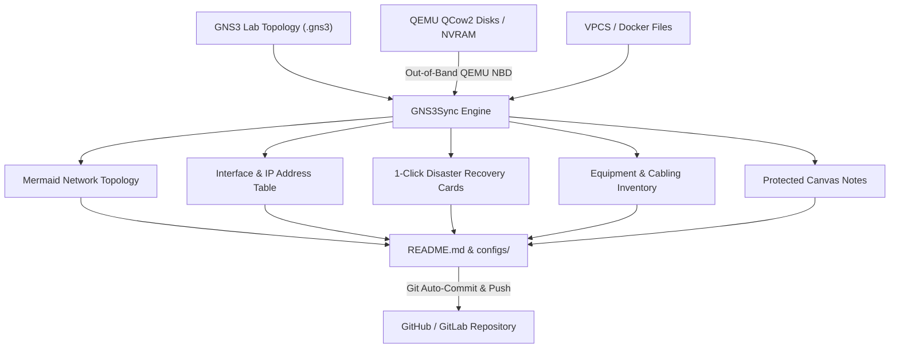

# 🌐 GNS3Sync

> **Automated GitOps, Live Topology Documentation & 1-Click Disaster Recovery for GNS3 Labs.**

[](LICENSE)
[](https://www.python.org/)
[](#supported-platforms)
[](#)

GNS3Sync automatically transforms your active GNS3 networking labs into **interactive, production-grade GitHub documentation** with zero cloud agent overhead. It inspects VM disk images and NVRAM **out-of-band**, extracts live router, switch, and server configurations, renders GitHub-native **Mermaid diagrams**, and builds **1-Click Disaster Recovery** pasteable cards so you can restore any wiped node in seconds.

---

## 🚀 Key Features

* **🔌 Multi-Vendor Out-of-Band Extraction:** Extracts startup and running configs directly from QEMU qcow2 disks, NVRAM, and VPCS startup files without requiring telnet/SSH credentials into running nodes.
* **🗺️ Automatic Mermaid Topology Diagrams:** Translates GNS3 links, nodes, and interfaces into interactive GitHub diagrams that render directly in Markdown.
* **⚡ 1-Click Disaster Recovery Accordions:** Generates copy-pasteable CLI commands tailored to each vendor (`enable -> conf t`, `sudo tee /etc/network/interfaces`, Arista, Juniper, etc.) to immediately restore broken nodes.
* **⏪ GitOps Version History & Rollback:** Compares previous commits and generates 1-step rollback snippets directly in the README.
* **🛡️ Protected Layout Engine:** Intelligently wraps canvas notes and IP addressing annotations into collapsible `<details>` blocks to ensure the documentation layout is never disrupted.
* **🔄 Fast Project Switcher (`gns3-switch`):** Switch which lab is active on GitHub in one command, with automatic cleanup of stale configs from previous projects.
* **📦 Dual-Sync Architecture:** Back up your primary group lab to your main repository while archiving all personal labs simultaneously.

---

## 🖥️ Supported Platforms

| Platform | Extraction Method | Restoration Language | Output Format |
| :--- | :--- | :--- | :--- |
| **Cisco IOS (vIOS / IOU)** | NVRAM binary scan (`strings`) | Cisco CLI (`conf t`) | `.cfg` Running-Config |
| **Cisco ASA Firewall (ASAv)** | NVRAM binary scan (`strings`) | Cisco CLI (`conf t`) | `.cfg` Running-Config |
| **Arista EOS (vEOS)** | Flash Mount (`/mnt/flash/startup-config`) | Arista CLI | `.cfg` Startup-Config |
| **Juniper Junos (vJunos)** | QEMU Disk inspection / DHCP lease | Junos CLI (`load override`) | Active IP & Config |
| **VyOS** | Config Mount (`/config/config.boot`) | VyOS CLI commands | `config.boot` |
| **Linux (Debian / Alpine)** | Filesystem Mount (`/etc/network/interfaces`) | Bash (`sudo tee ...`) | Debian interfaces |
| **Ubuntu Linux** | Netplan YAML (`/etc/netplan/*.yaml`) | Bash (`sudo tee ... && netplan apply`) | Netplan YAML |
| **FreeBSD / OPNsense / pfSense** | RC Conf Mount (`/etc/rc.conf`) | Shell (`rc.conf`) | `rc.conf` |
| **VPCS (Virtual PC)** | Startup file parsing | Plain text | VPCS Script |
| **Docker Containers** | Container interface filesystem | Bash command | Linux interfaces |

---

## ⚙️ Architecture & Workflow



---

## 📦 Quickstart Installation

### 1. Clone the Repository
```bash
git clone https://github.com/hugomossberg/gns3-sync.git
cd gns3-sync
```

### 2. Run the Universal Installer
```bash
sudo ./install.sh
```
The installer will:
1. Check for dependencies (`python3`, `git`, `qemu-utils`, `binutils`).
2. Install `gns3sync` and `gns3-switch` to `/usr/local/bin`.
3. Configure passwordless sudo permissions for safe out-of-band disk mounting.
4. Optionally install and enable the background **systemd timer** (auto-sync every 30 minutes).

### 3. Run the Interactive Setup Wizard
```bash
gns3sync init
```
Follow the interactive prompts:
* Specify your GNS3 projects folder (e.g. `~/GNS3/projects` or `/opt/gns3/projects`).
* Set your local Git export directory (default: `~/gns3-export`).
* Provide your remote GitHub repository URL (SSH or HTTPS).

> [!TIP]
> **Connecting to GitHub without GitHub CLI (Super Simple):**
> 1. Go to [github.com/new](https://github.com/new) in your browser.
> 2. Choose a name (e.g. `my-gns3-labs`) and select **Private** (recommended).
> 3. Click **Create repository**.
> 4. Copy the URL (`git@github.com:username/my-gns3-labs.git` or HTTPS `https://github.com/username/my-gns3-labs.git`).
> 5. Paste it into the `gns3sync init` wizard!

### 4. Verify Your Setup
```bash
gns3sync status
```

### 5. Perform Your First Sync
```bash
gns3sync
```
Your GitHub repository will instantly be populated with full Mermaid topology diagrams, IP tables, and disaster recovery cards!

---

## 📖 How-To Guides & Tutorials

### Tutorial 1: Connecting your first GNS3 project to GitHub
1. Open your lab in GNS3 (or check your projects folder).
2. Run `gns3sync switch`:
   ```bash
   gns3-switch
   ```
3. Type the number corresponding to your project.
4. GNS3Sync automatically parses your topology, creates the GitHub markdown, and pushes directly to your repository!

### Tutorial 2: Reviving a crashed or wiped node in 10 seconds
1. Open your GitHub repository in your browser.
2. Scroll to the **⚡ Disaster Recovery & 1-Click Rollback** section.
3. Click on the card for your crashed node (e.g., `🖥️ R1-Cisco`).
4. Click the **Copy** button in the code block.
5. In your GNS3 console, paste the snippet directly into the terminal. Your node is completely restored to its active working state!

### Tutorial 3: Switching between different lab assignments
If you have multiple courses or lab exercises:
```bash
# List all your labs and see which one is currently on GitHub:
gns3-switch list

# Switch to your homework lab:
gns3-switch labb2

# Later, switch back to your group project:
gns3-switch grupparbete
```
GNS3Sync cleans out previous configs and ensures your GitHub repository is updated with the exact project you selected.

---

## 🛠️ CLI Reference

| Command | Description |
| :--- | :--- |
| `gns3sync` (or `gns3sync sync`) | Runs full GitOps synchronization and pushes to GitHub |
| `gns3sync switch [project]` | Switches the active project (interactive or specify name/number) |
| `gns3sync list` | Lists all detected GNS3 projects with active indicator |
| `gns3sync status` | Comprehensive health check of paths, remotes, and dependencies |
| `gns3sync init` | Interactive setup wizard for a new machine |
| `gns3-switch` | Shortcut for fast interactive project switching |

---

## 📝 Configuration File (`config.yaml`)

Configuration is stored at `/etc/gns3sync/config.yaml` or `~/.config/gns3sync/config.yaml`:

```yaml
# Path where your GNS3 projects reside on disk
projects_dir: "~/GNS3/projects"

# Path where the primary Git repository is exported
export_dir: "~/gns3-export/primary"

# Remote GitHub / Git repository
repo_url: "git@github.com:username/my-gns3-lab.git"

# Keywords used to match your active primary project
project_keywords:
  - "routing_switching"
  - "grupparbete"

# Dual-Sync Archive for all other labs (optional)
personal_export_dir: "~/gns3-export/archive"

# QEMU NBD Mount settings for out-of-band inspection
mount_point: "/mnt/gns3_inspect"
nbd_dev: "/dev/nbd0"

# Automatically commit and push to remote repository
auto_push: true
```

---

## ⏱️ Background Automation

### Option A: Systemd Timer (Recommended)
If you enabled the systemd timer during installation:
```bash
# Check timer status
systemctl status gns3sync.timer

# View sync logs in real-time
journalctl -u gns3sync.service -f
```

### Option B: Crontab
Add the following line to your user's crontab (`crontab -e`):
```cron
*/30 * * * * /usr/local/bin/gns3sync sync >/dev/null 2>&1
```

---

## 🧪 Testing

Run the included unit test suite:
```bash
python3 tests/test_parser.py
```

---

## 📄 License

This project is licensed under the [MIT License](LICENSE).  
Created by **Hugo Mossberg** (2026).
